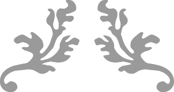
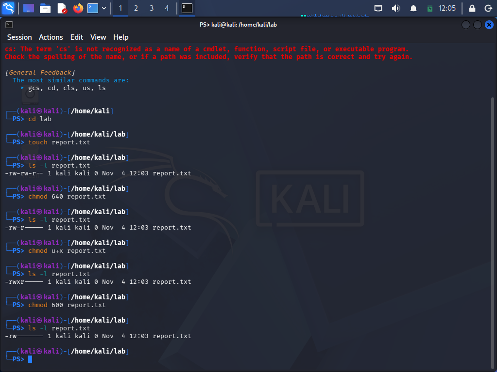
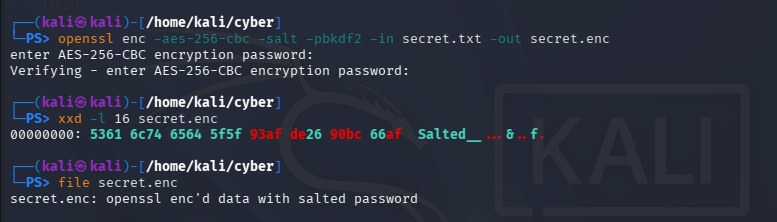
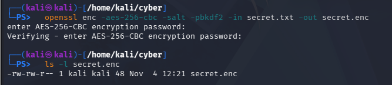
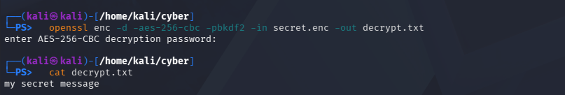

{width="1.55in"
height="0.8211920384951881in"}

DFCS Day 1 ASSIGNMENT

Name: Wazir Jawad Ahmed

{width="0.83in"
height="0.5237664041994751in"}

**\**

# Task A: Malware Types and Examples

| **Type** | **Definition in My Own Words** | **Named Example + Year** | **How It Spread** | **Primary Impact** |
|---|---|---|---|---|
| **Virus** | A program that attaches itself to another file, usually an `.exe`, and only runs and spreads when someone runs that infected file. | **CIH (Chernobyl Virus), 1998** | Infected executables passed around on floppies, pirated software and email attachments. | Overwrote data on the hard disk and, on some motherboards, wiped the BIOS flash chip so the PC would not even start. |
| **Worm** | Malware that copies itself from machine to machine over the network by abusing a bug in a service. Nobody has to click anything. | **WannaCry, May 2017** | Used the EternalBlue exploit against SMBv1 file sharing on unpatched Windows PCs, then scanned for more victims. | Encrypted files and asked for Bitcoin. It hit around 150 countries and forced UK NHS hospitals to cancel appointments. |
| **Trojan** | Malware that pretends to be something useful or harmless, so the user installs it themselves. It does not spread on its own. | **Zeus (Zbot), 2007** | Phishing emails and drive by downloads from hacked websites. | Logged keystrokes and grabbed login forms inside the browser to steal online banking details and empty accounts. |
| **Ransomware** | Malware that locks or encrypts your files and demands money for the key to get them back. | **REvil via Kaseya VSA, July 2021** | Supply chain attack: criminals abused a flaw in Kaseya remote management software and pushed ransomware to its customers as if it were an update. | Hit IT service providers and, through them, 1,500 small businesses. REvil asked for seventy million dollars to unlock everything. |
| **Spyware** | Software that secretly watches what you do and sends it to someone else. | **Pegasus (NSO Group), founded 2016, widely exposed 2021** | Malicious links at first, later zero click exploits through iMessage and WhatsApp that needed no tap from the victim. | Full access to the phone: messages, calls, camera, microphone and location. Used against journalists, activists and politicians. |
| **Adware** | Software that pushes unwanted ads, often by changing browser settings or injecting ads into pages, to earn money for its owner. | **Fireball, 2017** | Bundled inside free software that people downloaded and installed. | Hijacked the home page and search engine on an estimated 250 million computers and could also download more malware. |
| **Rootkit** | Malware built to hide itself and other malware from the operating system and antivirus by running at an exceptionally low level. | **Sony BMG XCP, 2005** | Installed itself when someone played one of Sony's music CDs on a Windows PC. | Hid files and processes and left the PC open for other malware to hide behind it. Led to a recall and lawsuits. |
| **Keylogger** | Records every key you press, so the attacker gets passwords, card numbers and chats. | **Agent Tesla, 2014 onward** | Cheap commercial tool sold online; delivered by phishing emails with booby trapped Office or archive attachments. | Stole saved browser passwords, screenshots and keystrokes and sent them out by email or FTP, often from small and mid sized companies. |
| **Botnet Agent** | A small program that turns an infected device into a bot waiting for orders from a command server, so thousands can attack together. | **Mirai, 2016** | Scanned the internet for cameras and routers and logged in with factory default passwords. | Its botnet launched the DDoS on DNS provider Dyn in October 2016, knocking sites like Twitter, Netflix and Reddit offline for many users. |
| **Fileless / Living Off the Land** | Attacks that use tools already on the machine (PowerShell, WMI, scheduled tasks) and live in memory or the registry, so there is little or no malicious file to scan. | **Operation Cobalt Kitty (APT32 / OceanLotus), 2017** | Spear phishing first, then PowerShell, WMI and scheduled tasks to stay on the network. | Months of quiet spying inside a large corporation in Southeast Asia. |
| **Logic Bomb** | Code that sits quietly until a condition is met, like a date or an account being deleted, and then does damage. | **UBS PaineWebber (Roger Duronio), 2002** | Not spread at all. Planted by an insider who was a system administrator. | Deleted files on around 2,000 servers across the company's branches and cost millions to recover. Duronio was sent to prison. |
| **Bootkit** | A rootkit that infects the boot process (the MBR or boot sector) so it loads before the operating system and security tools do. | **TDL4 (TDSS), 2010** | Installed through a pay per install network, mostly from infected downloads and hacked websites. | Survived reinstalls and hid from antivirus. Built a botnet of millions of PCs used for fraud and spam. |
## Which type is most dangerous for a Pakistani SME?

I think ransomware is the biggest threat for Pakistani SMEs because most
small businesses keep their orders, accounts and customer data on just
one or two Windows computers, and usually don\'t even have proper
backups. If all those files get encrypted, the whole business can come
to a stop. On top of that, the ransom demanded in dollars or Bitcoin can
be more than what a small business earns in a month.

Things like pirated Windows and Office, outdated systems, and employees
opening unknown email or WhatsApp attachments make these businesses even
more vulnerable. Attacks like WannaCry and Kaseya show how serious this
can be. Most small businesses also don\'t have a dedicated IT person to
monitor their systems or deal with such attacks.

# Task B2: Change permissions three ways with chmod

## Commands

> mkdir lab && cd lab
>
> touch report.txt
>
> ls -l report.txt \# BEFORE (default, usually 644)
>
> chmod 640 report.txt \# change 1: octal
>
> ls -l report.txt
>
> chmod u+x report.txt \# change 2: symbolic
>
> ls -l report.txt
>
> chmod 600 report.txt \# change 3: octal
>
> ls -l report.txt

## What you should see

  ----------------------------------------------------------------------------------
  **\#**   **Command**      **Expected ls -l** **Octal**   **What it did**
  -------- ---------------- ------------------ ----------- -------------------------
  0        touch report.txt -rw-r\--r\--       644         Starting point: owner
                                                           read/write, everyone else
                                                           read only.

  1        chmod 640        -rw-r\-\-\-\--     640         Group keeps read only
           report.txt                                      (4). Others lose all
           (octal)                                         access (0), so they can
                                                           no longer read the file.

  2        chmod u+x        -rwxr\-\-\-\--     740         Adds execute for the
           report.txt                                      owner only. Group and
           (symbolic)                                      others are untouched. The
                                                           owner could now run it as
                                                           a program.

  3        chmod 600        -rw\-\-\-\-\-\--   600         Removes execute from the
           report.txt                                      owner and read from the
           (octal)                                         group. Only the owner can
                                                           read and write. This is
                                                           the right mode for
                                                           private files like keys.
  ----------------------------------------------------------------------------------

## Screenshots

  -----------------------------------------------------------------------
  {width="6.768055555555556in"
                      height="2.4950492125984254in"}

  -----------------------------------------------------------------------

  -----------------------------------------------------------------------
  {width="6.501432633420823in"
                      height="0.8617290026246719in"}

  -----------------------------------------------------------------------

  -----------------------------------------------------------------------
  {width="6.768055555555556in"
                      height="0.8104647856517935in"}

  -----------------------------------------------------------------------

  -----------------------------------------------------------------------
   {width="6.768055555555556in"
                       height="1.158173665791776in"}

  -----------------------------------------------------------------------

## Explanation 

Change 1 (640): I used octal to set owner read/write, group read, and
nothing for others. Others can no longer open the file.

Change 2 (u+x): I used symbolic mode to add execute for the owner only.
The mode went from 640 to 740 and nothing else changed.

Change 3 (600): I went back to octal and locked the file down so only
the owner can read and write it, like a private key file.

# Task B4: Encrypt with OpenSSL, read the header with xxd

## Commands

> mkdir -p \~/cyber && cd \~/cyber
>
> echo \"my secret message\" \> secret.txt
>
> \# encrypt
>
> openssl enc -aes-256-cbc -salt -pbkdf2 -in secret.txt -out secret.enc
>
> ls -l secret.txt secret.enc
>
> \# look inside the encrypted file
>
> xxd -l 16 secret.enc
>
> file secret.enc
>
> \# decrypt to prove it works (use the SAME flags, including -pbkdf2)
>
> openssl enc -d -aes-256-cbc -pbkdf2 -in secret.enc -out decrypt.txt
>
> cat decrypt.txt

## What you should see

> 00000000: 5361 6c74 6564 5f5f xxxx xxxx xxxx xxxx Salted\_\_\...\.....
>
> secret.enc: openssl enc\'d data with salted password
>
> my secret message

The last 8 bytes in the xxd line (the x characters above) are random, so
yours will look different. The first 8 bytes must read Salted\_\_.

## Screenshots

  -----------------------------------------------------------------------
   {width="6.768055555555556in"
                      height="1.9340277777777777in"}

  -----------------------------------------------------------------------

  -----------------------------------------------------------------------
   {width="6.768055555555556in"
                      height="1.4715277777777778in"}

  -----------------------------------------------------------------------

  -----------------------------------------------------------------------
   {width="6.768055555555556in"
                      height="1.1402777777777777in"}

  -----------------------------------------------------------------------

## Explanation 

# When OpenSSL uses \`-salt\`, it adds an 8-byte tag \`Salted\_\_\` at the beginning of the encrypted file. In hex, it looks like \`53 61 6c 74 65 64 5f 5f\`. The next 8 bytes contain a random salt, and everything after that is the encrypted data.

# The salt is not secret. OpenSSL stores it in the file because it needs it along with my password to generate the same key during decryption. Because a new random salt is generated every time, encrypting the same file with the same password twice will produce different outputs.

# Using \`file\` and \`xxd\`, I can quickly identify whether an unknown file uses OpenSSL\'s salted encryption format without even knowing the password.
